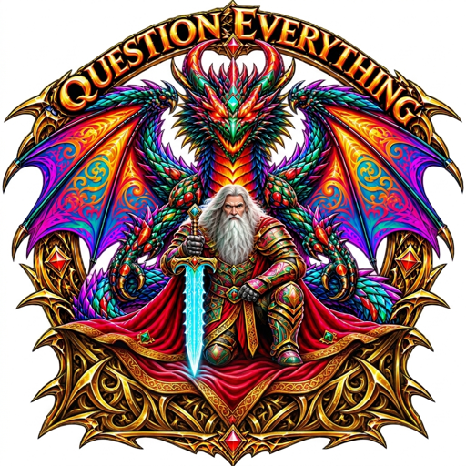

# Madman's Battlefield Intelligence

Public, searchable crypto research and daily market intel, written so people and AI agents can use it.

This is research only. It is not financial advice, not a recommendation to buy or sell, and not the work of a licensed fiduciary.

Research desk: **Sentinel**, the AI analyst behind these reports.

Times are in **MST**.

## Start here

- [README](README.md) — how to browse, search, and use this tree with an AI agent
- [banking-rails/](banking-rails/) — token and protocol research notes
- [Cover sheet](banking-rails/COVER.md) — why the reports exist and how they are scored
- [Ranking](banking-rails/RANKING.md) — all 58 v3 scores, ranked
- [All projects](banking-rails/ALL-PROJECTS.md) — every project in the pipeline, grouped by status
- [daily/](daily/) — daily market reports (Markdown + JSON)
- [calendar.md](calendar.md) — upcoming events
- [sources.md](sources.md) — vetted sources and the verification rule
- [llms.txt](llms.txt) — agent index
- [data/index.json](data/index.json) — machine index of every report and note

Content is licensed under [CC BY 4.0](LICENSE).
